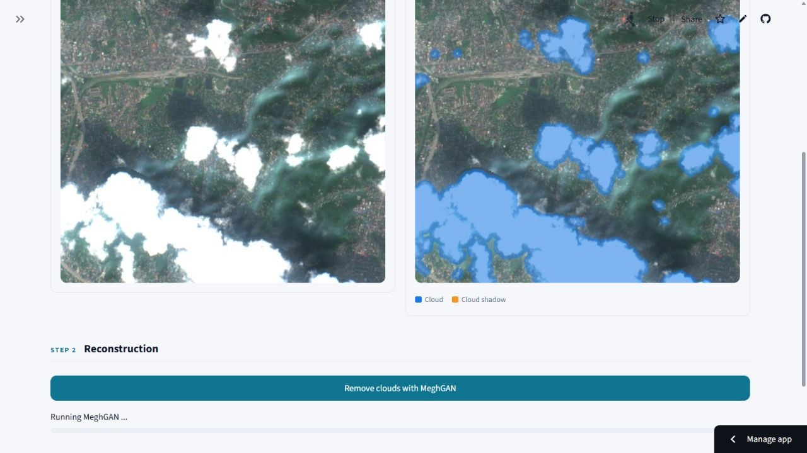
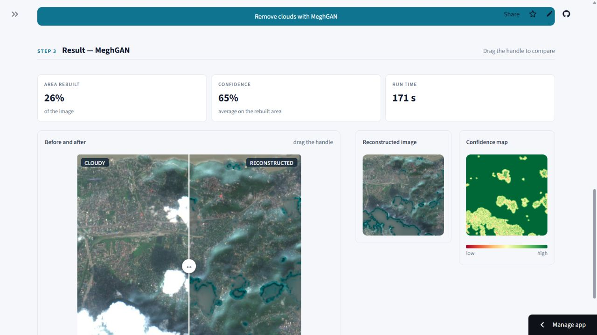
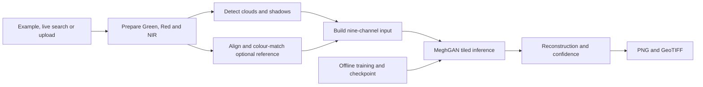

# MeghMukt

Cloud and shadow removal for optical satellite imagery in North-East India. Built as B.Tech Project-I (BCSE497J) at VIT Vellore.

[Open the live Streamlit dashboard](https://awbgqb3lbthslzjcuuzylh.streamlit.app/)

[Watch the animated walkthrough](screenshots/walkthrough.gif) · [Architecture notes](architecture/README.md)

## Dashboard screenshots

| Cloudy input and mask | MeghGAN result |
| --- | --- |
|  |  |

[Dashboard overview](screenshots/dashboard.jpg) · [PNG and GeoTIFF download controls](screenshots/downloads.jpg)

## What it does

MeghMukt detects clouds and shadows and estimates the ground beneath them. The dashboard accepts examples, live Sentinel-2 scenes, and uploads. It shows the detected mask, reconstructed image, and confidence map, then exports a PNG and a five-band GeoTIFF.

## Architecture

MeghGAN learns a correction over a reference-assisted starting image using an attention U-Net and a PatchGAN discriminator during training. The dashboard blends overlapping tile predictions. PyTorch runs the models, Rasterio handles spatial alignment and GeoTIFFs, OpenCV supports mask processing, Earth Search provides the Sentinel-2 archive, and Streamlit serves the UI.

## Results

The original benchmark scored affected regions on 13 real LISS-IV images from Guwahati, using a clear acquisition from a different date as the scoring reference.

| Model | PSNR (dB) | SSIM | SAM (°) |
|---|---|---|---|
| Cloudy input | 27.42 | 0.778 | 3.97 |
| Temporal fill | 30.58 | 0.803 | 5.28 |
| U-Net | 26.61 | 0.678 | 6.67 |
| Diffusion | 31.24 | 0.798 | 4.98 |
| MeghGAN | **33.54** | **0.860** | **3.81** |

The later setup adds hybrid masking, local reference matching, robustness training, and a shared model for both sensors.

| PSNR on cloudy area (dB) | LISS-IV real | LISS-IV simulated | Sentinel-2 real | Sentinel-2 simulated |
|---|---|---|---|---|
| MeghGAN before | 33.54 | 33.34 | 32.25 | 36.28 |
| MeghGAN after | 34.22 | 33.59 | 32.57 | 36.43 |

## Hosted verification

The first hosted smoke test used the bundled 512 × 512 JPG. MeghGAN completed in 165 seconds and rebuilt 26% of the image. The screenshots show a later run on the same sample. PNG and GeoTIFF downloads both worked. Geographic alignment remains untested on a georeferenced input.

## Limitations

A reference from another date can miss floods, construction, or other changes. The reconstructed region is an estimate, and the confidence map is a heuristic. Soft blending can affect a narrow halo around the detected mask.

## Data credits

Sentinel-2 includes modified Copernicus Sentinel data. LISS-IV imagery is from ISRO / NRSC, Bhoonidhi.
