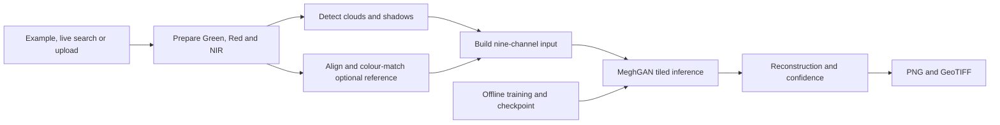

# MeghMukt architecture

MeghGAN learns a correction over a reference-assisted starting image using an attention U-Net and a PatchGAN discriminator during training. The dashboard blends overlapping tile predictions. PyTorch runs the models, Rasterio handles spatial alignment and GeoTIFFs, OpenCV supports mask processing, Earth Search provides the Sentinel-2 archive, and Streamlit serves the UI.
